<a href="https://asilturkmen.com"><picture>
  <source media="(max-width: 600px) and (prefers-reduced-motion: reduce)" srcset="assets/hero-mobile-still.svg">
  <source media="(max-width: 600px)" srcset="assets/hero-mobile.svg">
  <source media="(prefers-reduced-motion: reduce)" srcset="assets/hero-still.svg">
  
</picture></a>

I'm **Asil Türkmen**, a Software Engineering student at Eastern Mediterranean University in North Cyprus. I work on web apps, APIs, automation and games. You can find more about my projects and my CV at **[asilturkmen.com](https://asilturkmen.com)**.

<a href="https://asilturkmen.com/projects/nedirbeo"><picture>
  <source media="(max-width: 600px) and (prefers-reduced-motion: reduce)" srcset="assets/work-nedirbeo-mobile-still.svg">
  <source media="(max-width: 600px)" srcset="assets/work-nedirbeo-mobile.svg">
  <source media="(prefers-reduced-motion: reduce)" srcset="assets/work-nedirbeo-still.svg">
  
</picture></a> 
<a href="https://asilturkmen.com/projects/nedirbeo"><b>Case study</b></a> · <a href="https://nedirbeo.com">nedirbeo.com</a>

<a href="https://asilturkmen.com/projects/wipeout"><picture>
  <source media="(max-width: 600px) and (prefers-reduced-motion: reduce)" srcset="assets/work-wipeout-mobile-still.svg">
  <source media="(max-width: 600px)" srcset="assets/work-wipeout-mobile.svg">
  <source media="(prefers-reduced-motion: reduce)" srcset="assets/work-wipeout-still.svg">
  
</picture></a> 
<a href="https://asilturkmen.com/projects/wipeout"><b>Case study</b></a> · <a href="https://softaiclub.emu.edu.tr/wipeout">softaiclub.emu.edu.tr/wipeout</a>

<a href="https://asilturkmen.com/projects/hesappcim"><picture>
  <source media="(max-width: 600px) and (prefers-reduced-motion: reduce)" srcset="assets/work-hesappcim-mobile-still.svg">
  <source media="(max-width: 600px)" srcset="assets/work-hesappcim-mobile.svg">
  <source media="(prefers-reduced-motion: reduce)" srcset="assets/work-hesappcim-still.svg">
  
</picture></a> 
<a href="https://asilturkmen.com/projects/hesappcim"><b>Case study</b></a> · <a href="https://hes-appcim.vercel.app">hes-appcim.vercel.app</a> · <a href="https://github.com/Asilturkmen/HesAppcim">Source</a>

<a href="https://asilturkmen.com/projects/yayla-yemek-evi"><picture>
  <source media="(max-width: 600px) and (prefers-reduced-motion: reduce)" srcset="assets/work-yayla-yemek-evi-mobile-still.svg">
  <source media="(max-width: 600px)" srcset="assets/work-yayla-yemek-evi-mobile.svg">
  <source media="(prefers-reduced-motion: reduce)" srcset="assets/work-yayla-yemek-evi-still.svg">
  
</picture></a> 
<a href="https://asilturkmen.com/projects/yayla-yemek-evi"><b>Case study</b></a> · <a href="https://www.yaylayemekevi.com">yaylayemekevi.com</a> · <a href="https://github.com/Asilturkmen/Yaylayemekevi">Source</a>

<a href="https://asilturkmen.com"><picture>
  <source media="(max-width: 600px) and (prefers-reduced-motion: reduce)" srcset="assets/tools-mobile-still.svg">
  <source media="(max-width: 600px)" srcset="assets/tools-mobile.svg">
  <source media="(prefers-reduced-motion: reduce)" srcset="assets/tools-still.svg">
  
</picture></a>

<a href="https://asilturkmen.com"><picture>
  <source media="(max-width: 600px) and (prefers-reduced-motion: reduce)" srcset="assets/dawn-mobile-still.svg">
  <source media="(max-width: 600px)" srcset="assets/dawn-mobile.svg">
  <source media="(prefers-reduced-motion: reduce)" srcset="assets/dawn-still.svg">
  
</picture></a>

<a href="https://www.linkedin.com/in/asil-t%C3%BCrkmen-224ab0241/">LinkedIn</a> · <a href="mailto:contact.asilturkmen@gmail.com">Email</a> · <a href="https://instagram.com/asil_turkmen28">Instagram</a> · <a href="https://asilturkmen.com/cv/cveng.pdf">CV</a> · <a href="https://buymeacoffee.com/turkmenasil">Buy me a coffee</a>

