<a href="https://asilturkmen.com/#gh-dark-mode-only">
<picture>
<source media="(prefers-reduced-motion: reduce) and (max-width: 600px)" srcset="assets/hero-dark-mobile-still.svg">
<source media="(prefers-reduced-motion: reduce)" srcset="assets/hero-dark-still.svg">
<source media="(max-width: 600px)" srcset="assets/hero-dark-mobile.svg">
</picture>
</a>
<a href="https://asilturkmen.com/#gh-light-mode-only">
<picture>
<source media="(prefers-reduced-motion: reduce) and (max-width: 600px)" srcset="assets/hero-light-mobile-still.svg">
<source media="(prefers-reduced-motion: reduce)" srcset="assets/hero-light-still.svg">
<source media="(max-width: 600px)" srcset="assets/hero-light-mobile.svg">
</picture>
</a>

The watch started when you opened this page.

I work on web apps, APIs, automation and games. You can find more about my projects and my CV at **[asilturkmen.com](https://asilturkmen.com)**.

### Selected work

<a href="https://nedirbeo.com/#gh-dark-mode-only"><picture>
<source media="(max-width: 600px)" srcset="assets/card-nedirbeo-dark-mobile.svg">
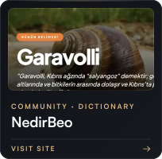
</picture></a>
<a href="https://nedirbeo.com/#gh-light-mode-only"><picture>
<source media="(max-width: 600px)" srcset="assets/card-nedirbeo-light-mobile.svg">
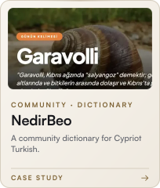
</picture></a>
<a href="https://asilturkmen.com/projects/wipeout#gh-dark-mode-only"><picture>
<source media="(max-width: 600px)" srcset="assets/card-wipeout-dark-mobile.svg">
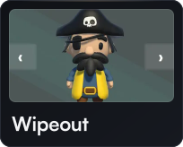
</picture></a>
<a href="https://asilturkmen.com/projects/wipeout#gh-light-mode-only"><picture>
<source media="(max-width: 600px)" srcset="assets/card-wipeout-light-mobile.svg">
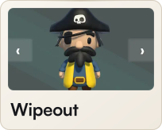
</picture></a>
<a href="https://asilturkmen.com/projects/hesappcim#gh-dark-mode-only"><picture>
<source media="(max-width: 600px)" srcset="assets/card-hesappcim-dark-mobile.svg">
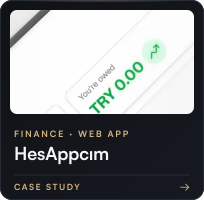
</picture></a>
<a href="https://asilturkmen.com/projects/hesappcim#gh-light-mode-only"><picture>
<source media="(max-width: 600px)" srcset="assets/card-hesappcim-light-mobile.svg">
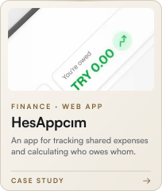
</picture></a>
<a href="https://www.yaylayemekevi.com/#gh-dark-mode-only"><picture>
<source media="(max-width: 600px)" srcset="assets/card-yayla-yemek-evi-dark-mobile.svg">
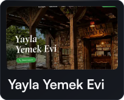
</picture></a>
<a href="https://www.yaylayemekevi.com/#gh-light-mode-only"><picture>
<source media="(max-width: 600px)" srcset="assets/card-yayla-yemek-evi-light-mobile.svg">
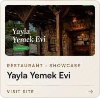
</picture></a>

### Tools I use

<a href="https://asilturkmen.com/#gh-dark-mode-only"><picture>
<source media="(max-width: 600px)" srcset="assets/tools-dark-mobile.svg">
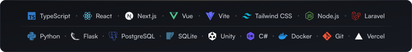
</picture></a><a href="https://asilturkmen.com/#gh-light-mode-only"><picture>
<source media="(max-width: 600px)" srcset="assets/tools-light-mobile.svg">
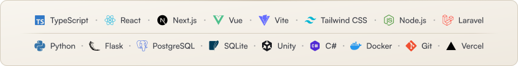
</picture></a>

<a href="https://asilturkmen.com/#gh-dark-mode-only"><picture>
<source media="(max-width: 600px)" srcset="assets/footer-dark-mobile.svg">

</picture></a><a href="https://asilturkmen.com/#gh-light-mode-only"><picture>
<source media="(max-width: 600px)" srcset="assets/footer-light-mobile.svg">

</picture></a>

&nbsp;&nbsp;
&nbsp;&nbsp;
&nbsp;&nbsp;

