<!-- Everything below is drawn by scripts/build.py. The plate is one 
 of images glued
     without whitespace (line breaks live inside tags) so GitHub shows a single surface. -->

<a href="https://asilturkmen.com"><picture><source media="(prefers-reduced-motion: reduce) and (max-width: 600px)" srcset="assets/hero-mobile-still.svg"><source media="(prefers-reduced-motion: reduce)" srcset="assets/hero-still.svg"><source media="(max-width: 600px)" srcset="assets/hero-mobile.svg"></picture></a><a
href="https://nedirbeo.com"><picture><source media="(max-width: 600px)" srcset="assets/card-nedirbeo-mobile.svg"></picture></a><a
href="https://eyll.itch.io/wipeout"><picture><source media="(max-width: 600px)" srcset="assets/card-wipeout-mobile.svg">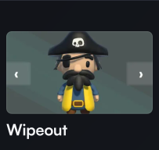</picture></a><a
href="https://hes-appcim.vercel.app/login"><picture><source media="(max-width: 600px)" srcset="assets/card-hesappcim-mobile.svg"></picture></a><a
href="https://www.yaylayemekevi.com"><picture><source media="(max-width: 600px)" srcset="assets/card-yayla-yemek-evi-mobile.svg"></picture></a><picture><source
media="(max-width: 600px)" srcset="assets/btn-nedirbeo-private-mobile.svg">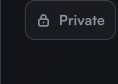</picture><a
href="https://nedirbeo.com"><picture><source media="(max-width: 600px)" srcset="assets/btn-nedirbeo-live-mobile.svg"></picture></a><picture><source
media="(max-width: 600px)" srcset="assets/btn-wipeout-private-mobile.svg">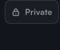</picture><a
href="https://eyll.itch.io/wipeout"><picture><source media="(max-width: 600px)" srcset="assets/btn-wipeout-live-mobile.svg">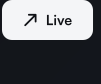</picture></a><a
href="https://github.com/Asilturkmen/HesAppcim"><picture><source media="(max-width: 600px)" srcset="assets/btn-hesappcim-code-mobile.svg">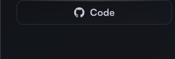</picture></a><a
href="https://hes-appcim.vercel.app/login"><picture><source media="(max-width: 600px)" srcset="assets/btn-hesappcim-live-mobile.svg"></picture></a><a
href="https://github.com/Asilturkmen/Yaylayemekevi"><picture><source media="(max-width: 600px)" srcset="assets/btn-yayla-yemek-evi-code-mobile.svg">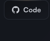</picture></a><a
href="https://www.yaylayemekevi.com"><picture><source media="(max-width: 600px)" srcset="assets/btn-yayla-yemek-evi-live-mobile.svg">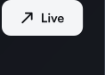</picture></a><a
href="https://asilturkmen.com"><picture><source media="(max-width: 600px)" srcset="assets/tools-mobile.svg">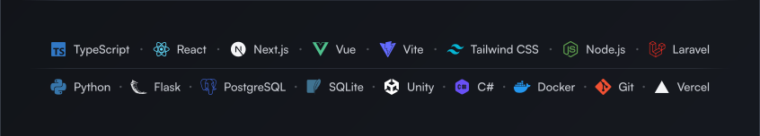</picture></a><a
href="https://asilturkmen.com"><picture><source media="(max-width: 600px)" srcset="assets/footer-mobile.svg">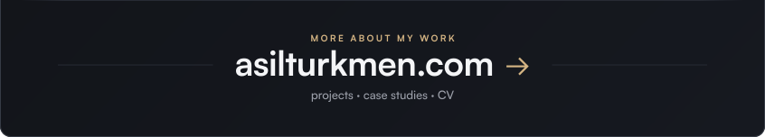</picture></a>

&nbsp;&nbsp;
&nbsp;&nbsp;
<a href="mailto:contact.asilturkmen@gmail.com">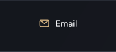</a>&nbsp;&nbsp;

